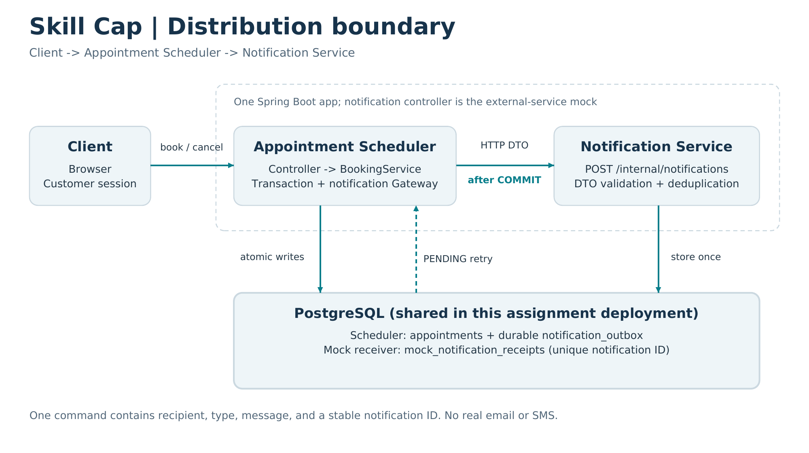

# Skill Cap - Milestone 3 Report

Daniel Khant | CMPE 172 | October 27, 2026

Repository: https://github.com/DenialCant/cmpe172-game-coaching-booking

Video link: ADD YOUR RECORDED WALKTHROUGH LINK BEFORE SUBMISSION

## Overview and distribution design

Skill Cap is a game coaching booking system using Spring Boot, Thymeleaf, JDBC,
and PostgreSQL. Milestone 3 adds an HTTP notification boundary, fault handling,
logging, health/metrics, Docker, and CI. The second controller is a mock messaging
service: it stores requests and does not send real email or SMS.



Client -> Appointment Scheduler -> Notification Service. Both controllers run in
one app and use the same PostgreSQL deployment for this assignment.

The coarse-grained NotificationRequest contains notificationId, recipient, type,
and message. The receiver gets everything it needs in a single POST. No entities,
passwords, or extra scheduler lookups cross the boundary. Types distinguish booking
and cancellation confirmations. Validation and a shared token protect the mock.

```java
public record NotificationRequest(
        String notificationId, String recipient,
        NotificationType type, String message) { }
```

The actual record includes Jakarta validation annotations.

## Commit-then-notify and idempotency

BookingService suspends caller transactions and calls a separate transaction bean.
BookingTransactionService locks the slot, writes the appointment, and inserts a
PENDING event into notification_outbox in one transaction. Only after that method
commits and returns does NotificationDispatcher call the HTTP Gateway. Cancellation
updates ownership-checked appointment state and enqueues its own event the same way.

```java
request = transactions.book(userId, slotId); // committed on return
metrics.bookingSucceeded();
dispatcher.dispatch(request);              // outside the transaction
```

If outbox insertion fails, the appointment change rolls back too. A notification
failure after commit cannot roll back booking. All attempts reuse the same ID and
payload. The mock stores IDs as primary keys: identical replay succeeds without
another receipt; changed data with the same ID gets HTTP 409. Both pending events
and receipt deduplication survive restarts.

## Fault handling and recovery

- Connection timeout: 500 ms. Read timeout: 1,000 ms per attempt.
- Maximum three immediate attempts, with 100/200 ms backoff.
- Network errors, 5xx, and 429 are retried. Other 4xx stop immediate retries.
- Fallback: leave the durable outbox event PENDING and return booking/cancellation success.
- Recovery worker: up to 25 pending events per pass, 30 seconds between passes.

```java
client.post().uri("/internal/notifications")
    .header("X-Notification-Token", properties.token())
    .body(request).retrieve().toBodilessEntity();
```

Failure scenario: the endpoint is down. Booking still confirms and logs a deferred
notification ID. Once the endpoint is restored, the worker sends pending events
without rebooking. A lost HTTP response can be replayed safely. Delivery can be
delayed/reordered; this is at-least-once retry with idempotent mock acceptance,
not exactly-once real email. A real receiver must implement the same contract.
Long-term deployment also needs retention policies for outbox/receipt records.

## Logging, health, and metrics

INFO logs cover committed booking/cancellation and accepted/delivered IDs/types.
WARN covers rejected booking, failed HTTP attempts, and deferrals. ERROR covers
database-health failures, unexpected dispatch failures, and failed recovery scans.
Application logs omit passwords, tokens, addresses, and message bodies. Invalid
notification payload errors are sanitized.

```text
INFO  Booking committed slotId=1 notificationId=appointment-1-booking-confirmation
WARN  Notification deferred notificationId=appointment-1-booking-confirmation recovery=outbox-retry
ERROR Database health check failed reason=SQLException
```

GET /health obtains a database connection and calls isValid(2). Healthy responses
are HTTP 200 with {"status":"UP","database":"UP"}; failures return HTTP 503 and
DOWN values. Pool acquisition waits at most three seconds and validation uses two
seconds. Noncritical notification availability is excluded from scheduler health.

```java
try (Connection connection = dataSource.getConnection()) {
    if (connection.isValid(2)) {
        return ResponseEntity.ok(Map.of("status", "UP", "database", "UP"));
    }
}
```

GET /metrics exposes bookings_total, failed_bookings_total, cancellations_total,
average_booking_latency_ms, notification_http_attempts_total,
notification_delivery_completions_total, and notification_deferrals_total. Counters
are per process and reset on restart. Booking latency includes notification waits
and failed calls. Replays can increment delivery/deferral counters again; these
are not unique email counts. This is JSON, not a Prometheus or hourly endpoint.

## Delivery and testing

The Dockerfile builds/tests the project and runs its JAR as a non-root user in a
Java runtime image. A Java health probe calls /health. Compose runs the app plus
PostgreSQL 16, waits for DB readiness, and retains data in a named volume.
GitHub Actions builds/tests every push and pull request, supplies a disposable
PostgreSQL service, validates Compose, and builds the Docker image.

```yaml
on:
  push:
  pull_request:
# In the build job:
- run: bash ./mvnw -B clean verify
```

Maven clean verify succeeded: 26 tests discovered, 24 passed, 0 failures, 0 errors,
2 skipped. The skipped tests need PostgreSQL and are enabled in CI. The executable
JAR was built. Tests verified real HTTP booking/cancellation with notifications
unreachable, commit visibility and released locks before HTTP, outbox rollback,
recovery/replay, duplicate protection, timeout/retry, DTO/token checks, health,
metrics, RBAC/provider rules, and the original two-customer booking race.
H2 models BOOKED-only uniqueness with a generated column; CI uses PostgreSQL's
production partial index. See Verification.md and maven-clean-verify.txt.

```java
var response = post(http, "/customer/appointments", "slotId=1");
assertEquals(302, response.statusCode());
assertEquals("BOOKED", jdbc.queryForObject("SELECT status FROM appointments", String.class));
assertEquals(1, pending());
```

Compose/workflow XML/YAML structures were checked. Docker startup, PostgreSQL-specific
runtime tests, and a real GitHub Actions run were not executed in this workspace.
Run Docker Desktop/Compose, push and inspect Actions, and add the minimum five-minute
code-walkthrough link plus real runtime evidence before submission.

## AI tools used

ChatGPT assisted with implementation, tests, documentation, and this report.
The recorded test results describe checks actually executed.
